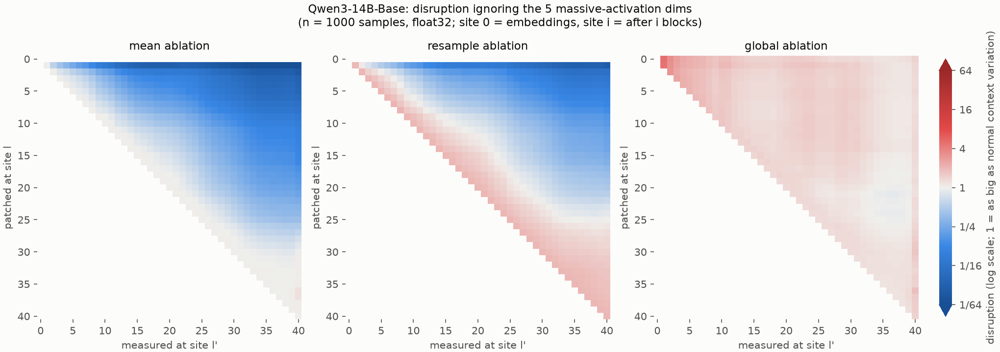
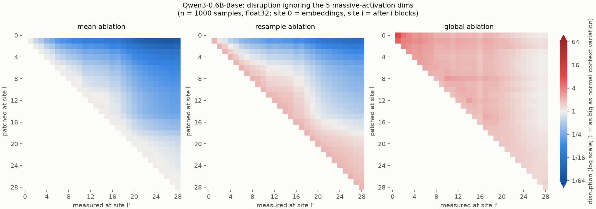
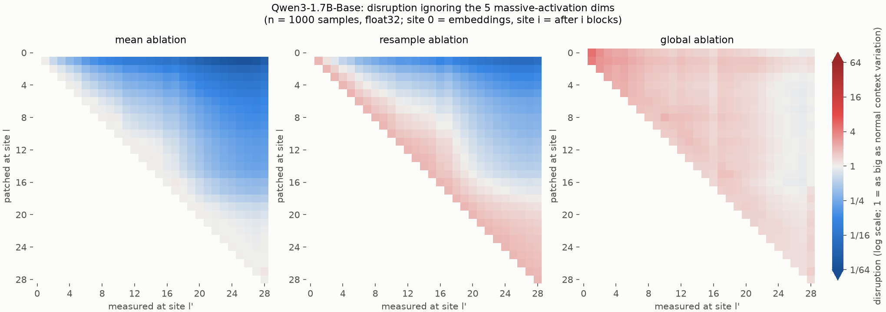
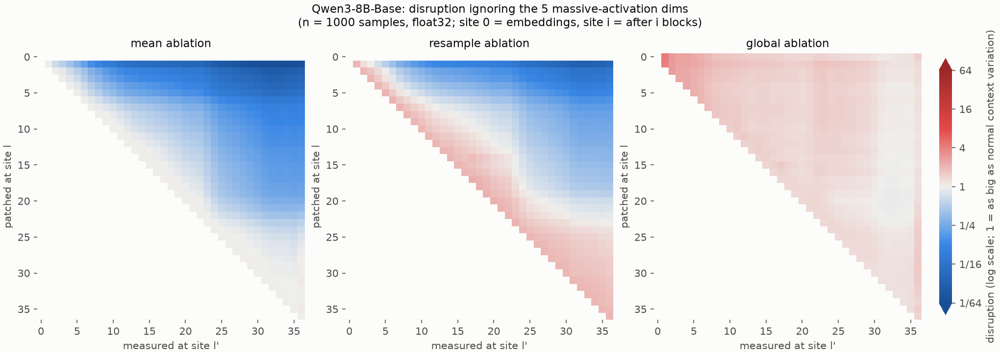

# Results: how self-correcting are Qwen3 base models?

**Setup.** For each Qwen3 base model (0.6B, 1.7B, 4B, 8B, 14B) we took 3,000 held-out FineWeb positions. At each one
we replaced the last position's residual stream after one block with an ablated value, then measured how far every
later block's output at that position moves from the clean run, and how much the next-token prediction changes.
Ablations:

- **mean**: the average activation of the same token across other contexts. It keeps the token but removes its context.
- **resample**: the activation of the same token in one other real context.
- **global**: the average over all tokens.

Earlier positions are left untouched, so the only way to recover is for later blocks to re-read the context from
them. Method and metric definitions are in [README.md](README.md). Data is on Hugging Face:
[`syvb/qwen3-last-position-patching`](https://huggingface.co/datasets/syvb/qwen3-last-position-patching). Curves are on W&B: `octahedral-systems/qwen3-self-correction`.

**Short answer.** Removing the context at the last position before about 55% depth changes the output little
(0.11–0.36 nats of KL for patches at 25–50% depth), at every model size. But this is mostly not active correction. The perturbation isn't removed;
later blocks write far more context-dependent state, read from the untouched earlier positions, and the early
perturbation ends up a small part of it. Only 4B, 8B and 14B also cancel much of the injected vector. Patches after
about 60–65% depth persist to the output at about full size.

The cross-size figure is from the main run, with all dimensions. The points at depth 0 for mean and resample ablation
are no-ops, because a token's embedding doesn't depend on context. The spike near depth 0.9 in the 14B disruption
curve comes from the massive-activation dimensions (see Caveats).

## The triangular matrices

Each panel is the (patched site × measured site) matrix for one ablation. Rows are the site that was patched, columns
the site where the perturbation is measured; site 0 = embeddings, site i = after i blocks. The colour is disruption on
a log scale: white = 1, i.e. the perturbation is as big as the natural difference between contexts for this token;
blue = smaller; red = larger. The scale is symmetric, from 1/64 to 64, so equal colour strength means an equal factor
away from 1. Reading along a row follows one patch through the later blocks, and the rightmost column
is what is left after the last block. Mean-ablation rows start at exactly 1 on the diagonal, and resample rows at ≈2,
because two real contexts differ by about twice the natural variation. Row 0 of the mean and resample panels is blank
because those patches are no-ops.

All five matrices here come from the 1,000-sample pass that leaves out the 5 massive-activation dimensions, so they
are on the same footing (see Caveats). The main 3,000-sample matrices, with all dimensions, are
`results/Qwen3-*-Base_disruption_sym.png`. Earlier versions of all these charts, with an asymmetric 1/64 to 8 scale
that makes red look stronger than blue, are kept as `results/Qwen3-*-Base_disruption.png` and
`results/Qwen3-*-Base_disruption_no_massive.png`.

In the mean panel, rows down to about site 27 (of 40) end up blue at the right edge, and rows from about site 30 end
near 1. In the resample panel, the boundary is at about site 25. That boundary is the transition in finding 1. The
global panel stays at or above 1 almost everywhere (finding 6). The other sizes show the same shape:

## Findings

1. **There is a transition at about 55–65% depth, at the same relative depth in every size.** "Disruption" is the
   size of the perturbation left after the last block, relative to how much this token's activations normally vary
   across contexts. It stays low and rises slowly for patches up to about 55% depth, then rises steeply over the next
   4–6 blocks. It passes 0.3 at relative depth 0.56–0.58, 0.5 at 0.61–0.65 (0.64, 0.64, 0.64, 0.61 and 0.65 for
   0.6B → 14B), and 0.7 at 0.67–0.71. With resample ablation, the final state ends up ~90% of the way back from the
   donor context to the true one when the patch is at 25% depth, ~75% at 50% depth, but only ~22% at 75% depth.

2. **Early patches change the output little, but not nothing.** With mean ablation, the output still moves by
   0.11–0.23 nats (KL) for patches at 25% depth and 0.26–0.36 nats at 50%. That compares with 1.75–2.3 nats at 75%
   and 4.2–6.1 nats for patches after the last block. Most individual samples are barely affected: the median
   disruption at 25% depth is 0.02–0.05. The averages are driven by a tail: in 0.6B, the top 10% of samples carry
   56% of the disruption and 68% of the KL at 25% depth. Word fragments (tokens without a leading space) have about
   3× the mean KL of whole words and are over-represented in that tail (11 of the top 50, against 5% of samples), but
   most of the tail is ordinary words. Digits are not over-represented.

3. **Bigger models are slightly less affected by early patches; depth and width can't be separated here.** At 25%
   depth, KL falls steadily with size, from 0.23 (0.6B) to 0.11 (14B) for mean ablation and from 0.56 to 0.28 for
   resample. The 0.6B and 14B values are well outside each other's doc-bootstrap bands. At 50% depth the sizes are
   indistinguishable: KL is 0.26–0.36 and disruption 0.22–0.25, not ordered by size. Models of equal depth (0.6B
   and 1.7B have 28 layers; 4B and 8B have 36) give nearly identical curves before the transition. After it, the
   wider model of each pair keeps 14–28% more of a late perturbation: final disruption at 75% depth is 0.80 vs 1.02
   and 0.90 vs 1.13 (0.74 vs 0.90 and 0.80 vs 0.91 without the massive dimensions). The equal-depth pairs are also
   neighbouring sizes, so this family can't separate the effect of depth from that of width.

4. **Most of the "recovery" is dilution, not repair.** An early patch's perturbation is not removed in absolute
   terms: for a patch at 25% depth, its squared size grows 30–390× by the last block (mean ablation, without the
   massive dimensions). Disruption still falls because the natural cross-context variation at the last position
   grows much faster over the same blocks, 240–2,800×. Later blocks write most of the context-dependent state from
   the untouched earlier positions, so the early patch ends up a small part of it. For patches before 50% depth,
   only about 2% of the final perturbation lies along the injected direction (at most 2.3%; 4.3% for resample in
   0.6B); the rest is new error created by later blocks. On top of that, some models do actively cancel the injected
   vector itself. After the last block, the share of it remaining for a patch at 25% depth is 0.70, 1.12, 0.23, 0.41
   and 0.41 (0.6B → 14B). 4B, 8B and 14B are down to 0.3–0.4 within 10 blocks, mostly through the MLPs of the blocks
   right after the patch (see `results/*_blocks.png`); 0.6B and 1.7B barely cancel it. After the transition, the
   injected direction is instead amplified: retained is 1.2–1.3 at 75% depth in every model. In 8B's main run, 3
   massive-activation samples pull this down to 0.83; without them it is 1.31.

5. **A wrong context hurts more than an average one.** Resample ablation moves the output 2.3–2.6× more than mean
   ablation at 25% depth, rising to 3.6–4.8× just before the transition. About a factor of 2 of that is built in:
   two real contexts differ by ~2× the natural variation, and for small perturbations KL grows with the squared size.

6. **Replacing the token itself is never recovered from, as expected.** Global ablation costs 3.3–4.0 nats of KL
   even at 25% depth, and its effect stays flat until the transition. This is structural rather than a finding about
   the models: under causal attention the current token exists only at the last position, so no later block can
   re-read it. It serves as a contrast: removing only the context (mean ablation) costs 0.11–0.23 nats at that depth.

This is consistent with Csordás et al. (2025), "Do Language Models Use Their Depth Efficiently?". They find that
second-half layers contribute much less to the residual stream than first-half ones, with a sharp shift around the
middle of the network. Their main subject is Llama 3.1; for Qwen 3 they report that the effect "seems to be less
pronounced, but still present". Our transition is somewhat later, at 55–65% depth. The two results describe the same
picture from different sides: if late layers write little, a late patch persists while an early one is outgrown.

## Caveats

- **Massive activations, mainly in 4B and 8B.** In a few samples, a patch switches a massive activation at the last
  position on or off: |patched − clean| reaches 4,000–13,000 from site 17 on, while clean values in those dimensions
  are normally below ~200 (in 4B, no clean sample exceeds 100 at sites 17–26). For patches at sites 1–16, just 3 of
  the 3,000 samples carry 74% (4B) and 93% (8B) of the mean-ablation perturbation measured at sites 17–25, against
  about 1% in 0.6B, 1.7B and 14B. In 8B the same samples distort the main run's retained share (0.07 at 50% depth
  and 0.83 at 75%; 0.61 and 1.31 without them), so `results/key_numbers.txt` and the 8B retained and per-block plots
  are unreliable in that range. The matrices above leave out the 5 dimensions with the largest mean activation. In
  4B that removes the band, apart from a faint streak at patch site 11. The 1,000-sample pass reuses roughly the main
  run's first 1,000 samples (with different donors), and these happen not to include 8B's two most extreme samples,
  so 8B's smooth matrix doesn't show that leaving out the dimensions fixes it. The massive dimensions also inflate
  final-site disruption for late patches in every model except 0.6B, by up to ~25% (14B patched at site 37: 1.59 →
  1.20; at 75% depth, 1.15 → 0.96). So late perturbations persist at about full size rather than clearly growing.
  The comparison is in `results/key_numbers.txt`.
- Only tokens with ≥500 occurrences in the means set are tested: 2,139 token types, 73% of positions. Function
  tokens and punctuation dominate. The text is English web data only, contexts are 64–511 tokens long, and only the
  final position is patched; positions after it are not simulated.
- Means were computed in bf16 and patching in fp32. The bf16-vs-fp32 gap in the means is 70–2000× below their
  sampling noise for both 0.6B and 14B (`results/check_means_*.txt`). A 100-sample CPU rerun of 0.6B reproduces the
  GPU metrics to a median relative difference of ≤1.4e-5.

## Cost

The pod ran for 3 h 39 min on 1× H100 SXM (RunPod secure cloud), about $14.60: 2 h 41 min for the main run (including installs and tests), 43 min
for the extra pass without the massive dimensions, and the rest for setup and copying results. Reproduce with
`run_all.sh` followed by `run_robust.sh`.
