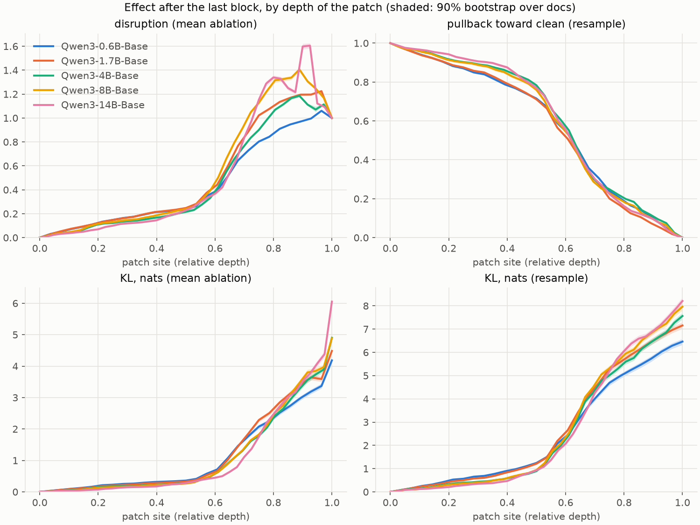
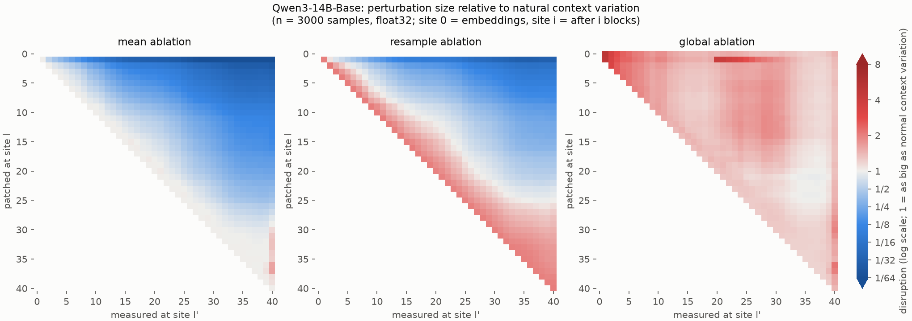
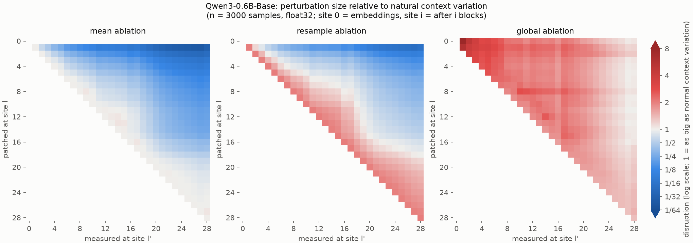
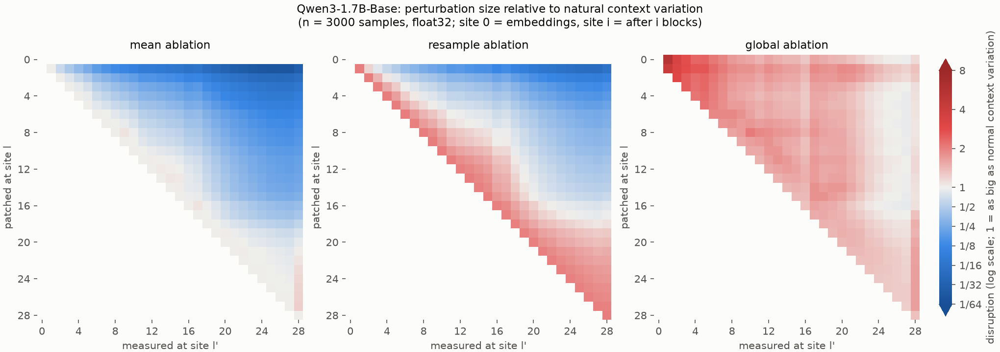
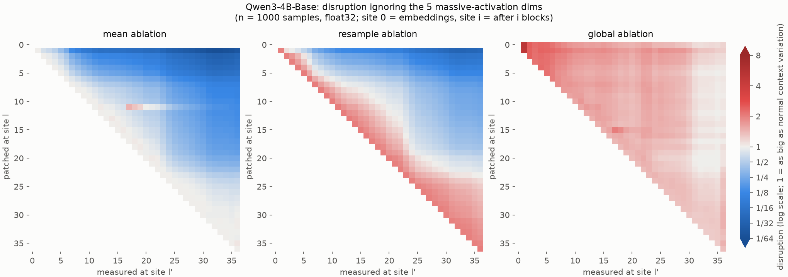
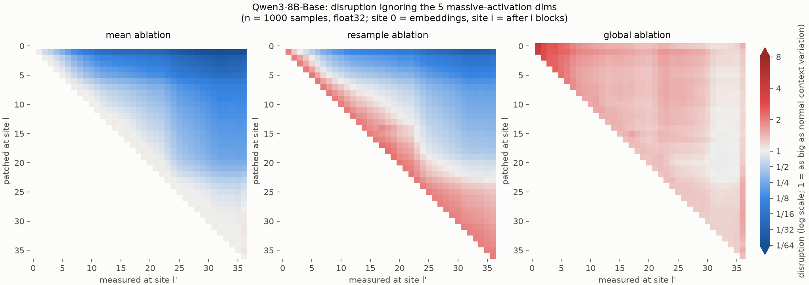

# Results: how self-correcting are Qwen3 base models?

**Setup.** For each Qwen3 base model (0.6B, 1.7B, 4B, 8B, 14B) we took 3,000 held-out FineWeb positions. At each one
we replaced the last position's residual stream after one block with an ablated value, then measured how far every
later block's output at that position moves from the clean run, and how much the next-token prediction changes.
Ablations:

- **mean**: the average activation of the same token across other contexts. It keeps the token but removes its context.
- **resample**: the activation of the same token in one other real context.
- **global**: the average over all tokens.

Earlier positions are left untouched, so the only way to recover is for later blocks to re-read the context from
them. Method and metric definitions are in [README.md](README.md). Data is on Hugging Face:
[`syvb/qwen3-last-position-patching`](https://huggingface.co/datasets/syvb/qwen3-last-position-patching). Curves are on W&B: `octahedral-systems/qwen3-self-correction`.

## The triangular matrices

Each panel is the (patched site × measured site) matrix for one ablation. Rows are the site that was patched, columns
the site where the perturbation is measured; site 0 = embeddings, site i = after i blocks. The colour is disruption on
a log scale: white = 1, i.e. the perturbation is as big as the natural difference between contexts for this token;
blue = smaller (recovered); red = larger. Reading along a row follows one patch through the later blocks, and the
rightmost column is what is left after the last block. Mean-ablation rows start at exactly 1 on the diagonal, and
resample rows at ≈2, because two real contexts differ by about twice the natural variation.

In the mean and resample panels, rows above about site 25 (of 40) end up blue at the right edge, and rows below it
stay white or red. That boundary is the transition in finding 1. The global panel stays at or above 1 almost everywhere, because the
token's identity is never recovered (finding 6). The other sizes show the same shape:

For 4B and 8B these are from the 1,000-sample pass that leaves out the 5 massive-activation dimensions. In their main
3,000-sample matrices ([4B](results/Qwen3-4B-Base_disruption.png), [8B](results/Qwen3-8B-Base_disruption.png)), a
band at measured sites 17–26 is dominated by 3 samples; see Caveats.

## Findings

1. **There is a sharp transition at about 60–65% depth, and it is the same at every size.** Context removed at the
   last position before that point mostly washes out by the end of the network; context removed after it does not.
   "Disruption" is the size of the remaining perturbation relative to how much this token's activations normally
   vary across contexts. It first reaches 0.5 at relative depth 0.64, 0.64, 0.64, 0.61 and 0.65 (0.6B → 14B). With
   resample ablation, the final state moves back ~90% of the way from the donor context to the true one when the
   patch is at 25% depth, ~75% at 50% depth, but only ~22% at 75% depth.

2. **Recovery before the transition is large but not complete.** With mean ablation, the output still moves by
   0.11–0.23 nats (KL) for patches at 25% depth and 0.26–0.36 nats at 50%. That compares with 1.75–2.3 nats at 75%
   and 4.2–6.1 nats for patches after the last block. Most individual samples recover almost fully: the median
   disruption at 25% depth is 0.02–0.05. The averages are driven by a tail of hard cases. In the 0.6B prototype these were
   mostly digits and word fragments.

3. **Bigger models recover slightly more, and width doesn't matter at fixed depth.** At 25% depth, KL falls from
   0.23 (0.6B) to 0.11 (14B) for mean ablation and from 0.56 to 0.28 for resample. Pairs with equal depth but
   different width give nearly identical curves: 0.6B vs 1.7B (28 layers), and 4B vs 8B (36 layers).

4. **Recovery means rebuilding the state, not undoing the patch.** For patches before ~50% depth, at most 2% of the
   final perturbation lies along the direction that was injected. Later blocks don't subtract the perturbation; they
   re-derive the context-dependent state from the intact earlier positions. How much of the injected vector is
   actively cancelled varies by model: after the last block, the share remaining for a patch at 25% depth is 0.70,
   1.12, 0.23, 0.41 and 0.41 (0.6B → 14B). 14B and 4B cancel it within about 10 blocks, mostly through the MLPs of
   the few blocks right after the patch (see `results/*_blocks.png`). After the transition, the injected direction
   is instead amplified: retained is 1.2–1.3 at 75% depth in every model except 8B (0.83).

5. **A wrong context hurts more than an average one.** Before the transition, resample ablation moves the output
   2.4–3.7× more than mean ablation. About a factor of 2 of that is built in, because two real contexts differ by
   ~2× the natural variation.

6. **The current token's identity is never recovered.** Global ablation costs 3.3–4.0 nats of KL even at 25% depth,
   and its effect stays flat until the transition. Nothing downstream can restore which token this was.

This fits Csordás et al. (2025). In Qwen 3 and Llama 3.1 they found that second-half layers contribute much less
to the residual stream, with a clear transition between the halves. Here, information lost after that transition is
not re-gathered.

## Caveats

- **Massive activations in 4B and 8B.** In a few samples, the patch switches a massive activation at the last
  position on or off: |patched − clean| reaches 4,000–13,000 at sites 17–26, while clean values in those dimensions
  are normally below ~100 (in 4B, no clean sample exceeds 100 there). In the main heatmaps
  (`results/Qwen3-{4B,8B}-Base_disruption.png`), just 3 of the 3,000 samples carry 74% (4B) and 93% (8B) of the
  mean-ablation perturbation in that band, against about 1% in 0.6B, 1.7B and 14B. So that band reflects a few
  samples, not typical behavior. A separate 1,000-sample pass that leaves out the 5 dimensions with the largest mean
  activation gives a smooth picture like the other models (`results/Qwen3-{4B,8B}-Base_disruption_no_massive.png`).
  Final-site disruption changes by at most ~20%: for patches at 75% depth it drops by 11% in 4B and 20% in 8B, and in
  8B/14B it goes from ~1.15 to ~0.9–0.96. So late perturbations persist at about full size rather than clearly
  growing (`results/summary_robust.txt`).
- Only tokens with ≥500 occurrences in the means set are tested: 2,139 token types, 73% of positions. Function
  tokens and punctuation dominate. The text is English web data only, contexts are 64–511 tokens long, and only the
  final position is patched; positions after it are not simulated.
- Means were computed in bf16 and patching in fp32. The bf16-vs-fp32 gap in the means is 70–2000× below their
  sampling noise for both 0.6B and 14B (`results/check_means_*.txt`).

## Cost

The GPU run took 3 h 39 min on 1× H100 SXM (RunPod secure cloud), about $14.60. That includes ~45 min for the extra
pass without the massive dimensions. Reproduce with `run_all.sh` followed by `run_robust.sh`.
